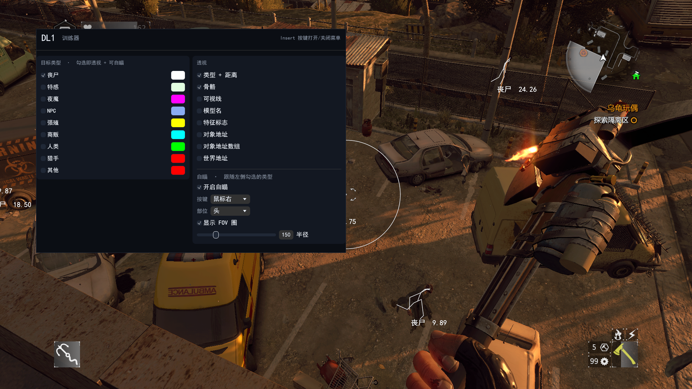

## Screenshots

## Usage

1. Install the **Desktop development with C++** workload for Visual Studio
2. Install the MSVC toolchain for Rust
3. Run `cargo build --release`
4. Inject the DLL compiled with the tool into the game